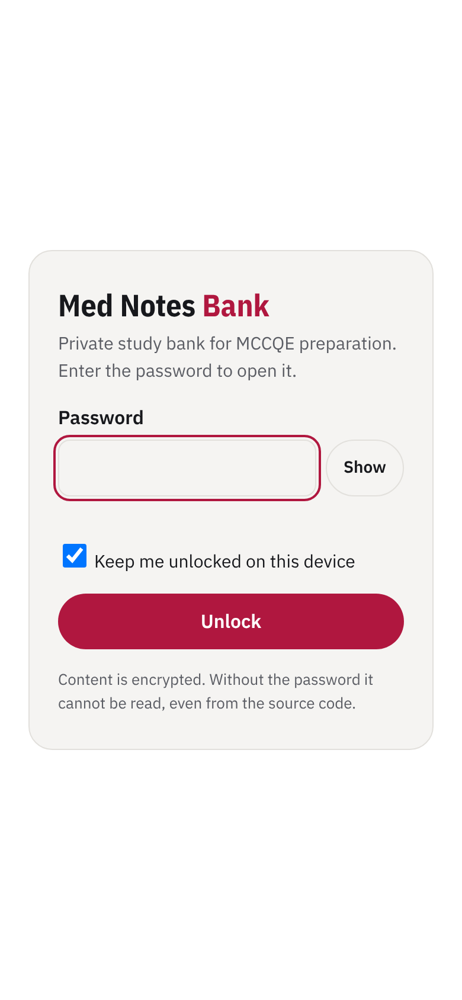
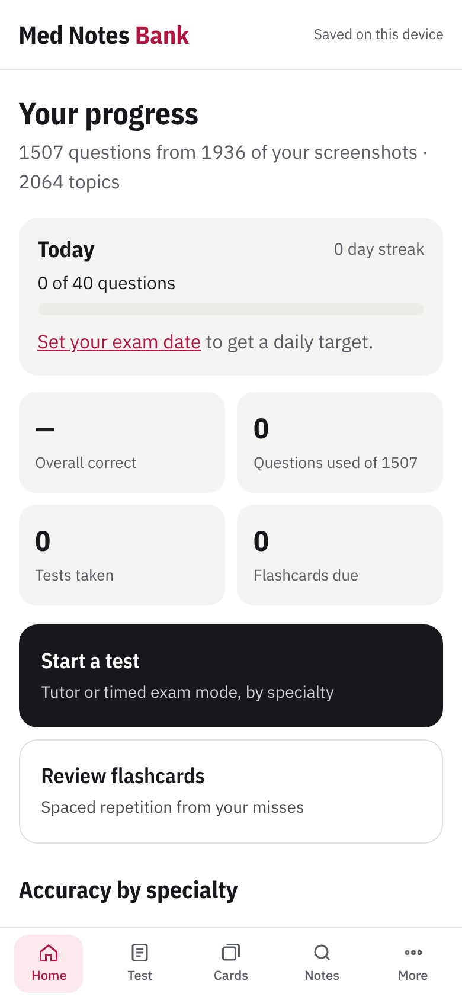
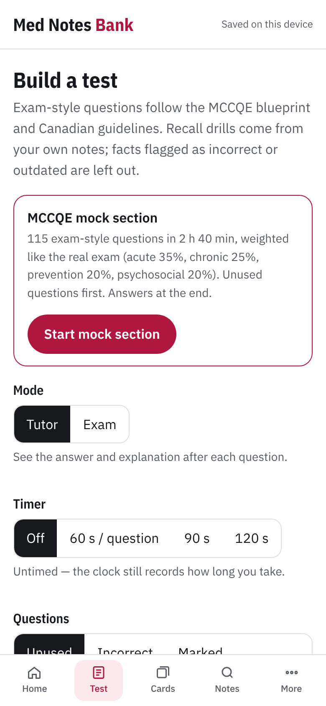
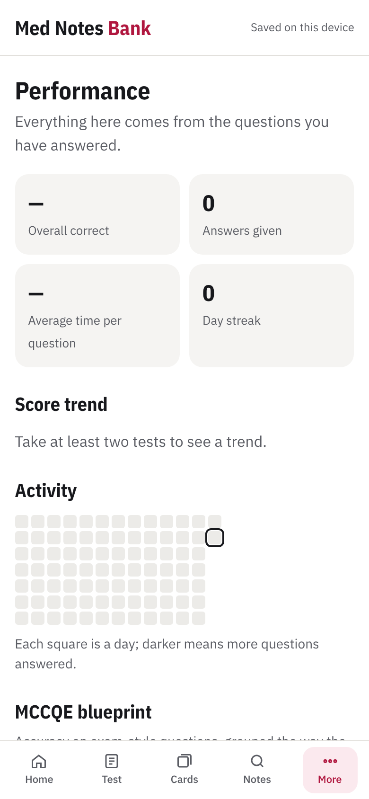

# Med Notes Bank

A private, mobile-first study bank for the **MCCQE** (Medical Council of Canada Qualifying Examination), built from about 2,000 study screenshots: deduplicated, fact-checked against Canadian guidelines, and turned into notes, exam-style questions, flashcards and a printable reference.

**Live site:** https://YOUR-USERNAME.github.io/med-notes-bank/ (password required)

<p>




</p>

## What's inside

| | |
|---|---|
| **Exam-style questions** | 351 clinical vignettes written to the MCCQE blueprint, each with 5 options, a reason for every option and a guideline source; independently reviewed against current Canadian guidance |
| **Recall drills** | About 1,150 one-line questions generated from the notes |
| **Notes** | 701 topics and 6,483 facts, including 41 Canadian-guideline summaries (ethics and law, screening, immunization, prenatal care, current treatment guidelines) |
| **Source screenshots** | 1,936 original images linked to their topics |
| **Mock exam** | 115-question, 2 h 40 min section weighted like the real exam |
| **Reference PDF** | 261-page printable summary with bookmarks, downloadable from inside the app |

### Features
- Tutor and timed exam modes, with a question navigator, mark-for-review, cross-out, lab values with an SI unit converter, and per-question notes
- Results review with answer-change tracking and time per question
- Performance by MCCQE dimension of care, physician activity and discipline, plus score trend, activity calendar and weakest topics
- Spaced-repetition flashcards, a daily goal, an exam-date countdown and streaks
- Write your own questions; star topics and add personal notes
- Backup and restore; light, dark and system themes; adjustable text size; keyboard shortcuts (`?`)
- Installable as an app (PWA) and works offline after the first visit

## Privacy and security

GitHub Pages sites are public, so **all study content is encrypted** before it is committed. Without the password the repository and the site contain only ciphertext.

- **Encryption:** AES-256-GCM, with each file compressed and then sealed with a unique IV, and its file name bound as associated data.
- **Key derivation:** PBKDF2-SHA-256 with 600,000 iterations and a random salt (`site/content/meta.json`).
- **Password handling:** the password never leaves the browser and is never stored. If you choose *Keep me unlocked*, only the derived key is kept on that device, as a non-extractable `CryptoKey` in IndexedDB. **Settings → Lock now** removes it.
- **Hardening:**
  - A strict Content Security Policy allows no third-party scripts, styles, fonts or connections; fonts are self-hosted.
  - `noindex` and `robots.txt` ask search engines not to index the site.
  - `no-referrer` is set.
- **Progress storage:** progress, notes and settings stay on each device in `localStorage`. Use **More → Backup** to move them between devices.

See [SECURITY.md](SECURITY.md) for the threat model and limits.

## Repository layout

```
site/                    The deployed static site (GitHub Pages serves this folder)
  index.html             App shell and lock screen
  assets/                app.js, vault.js (decryption), app.css, self-hosted fonts, icons
  content/               Encrypted content: data.enc, questions.enc, reference.pdf.enc, packs/*.enc
  sw.js                  Service worker for offline use
tests/smoke_test.py      CI tests: lock screen, wrong-password rejection, CSP, encryption, no third-party requests
.github/workflows/       Test, then deploy to Pages on every push to main
docs/                    README screenshots
```

Plaintext source material and the build pipeline are kept out of this repository by design. The encrypted bundle is rebuilt and committed whenever the content changes.

## Quality checks before each release

- 140+ end-to-end UI checks on phone (390 px) and desktop (1280 px) in light and dark themes. They cover every feature, check for horizontal overflow and fail on any JavaScript error.
- An automated accessibility audit (axe-core, WCAG 2.1 AA) of every view in both themes, with zero violations.
- A data QA pass over all questions and topics, plus an independent medical review of the exam-style questions.
- CI (`tests/smoke_test.py`) runs on every push and pull request. Deployment only happens if it passes.

## Browser support

Current Chrome, Edge, Firefox and Safari (desktop and mobile). The site needs Web Crypto and `DecompressionStream`; older browsers see a clear message instead of a broken page.

## Disclaimer

For personal exam preparation only. This is not clinical guidance; guidelines change, so check current Canadian sources before applying anything to patient care. Source screenshots remain the property of their respective owners and are stored encrypted for private study.

© 2026 Aidan. All rights reserved.
